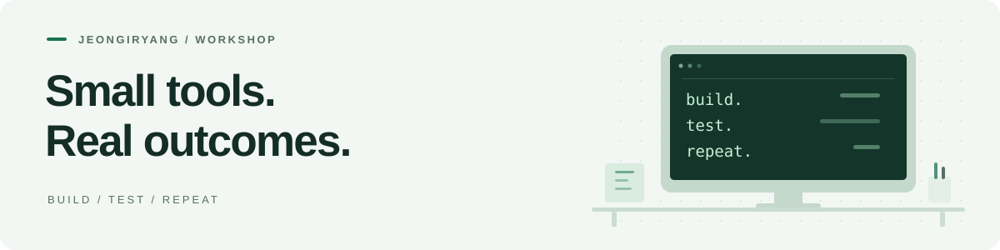
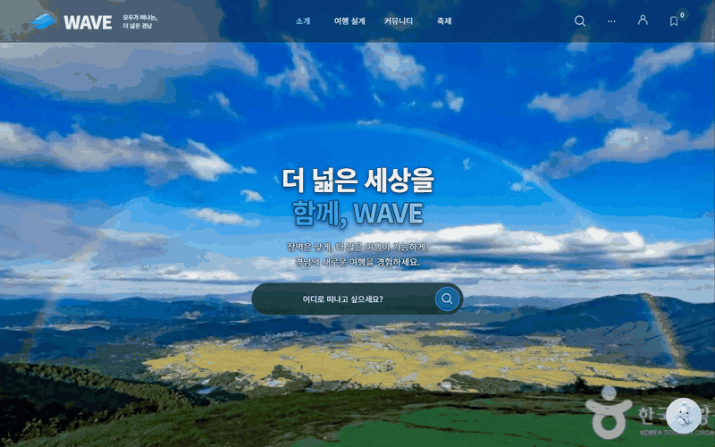
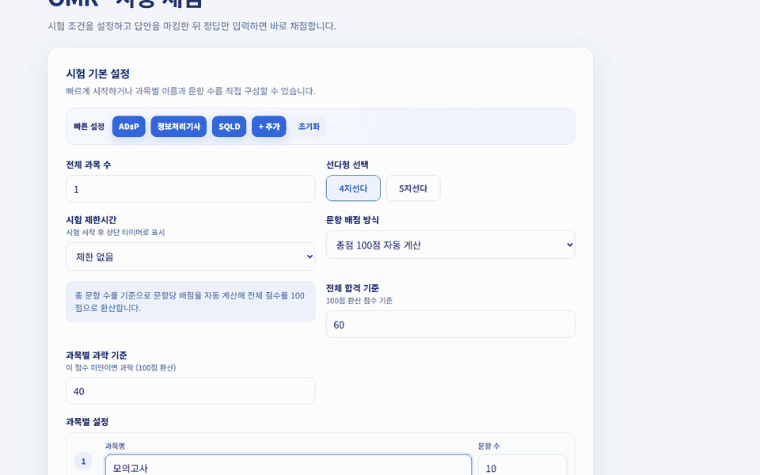
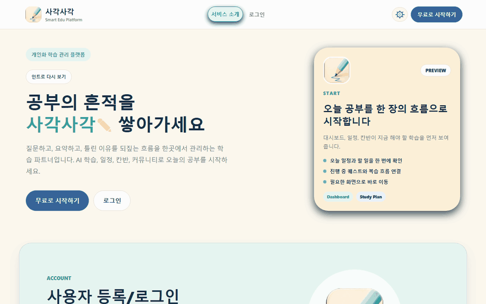
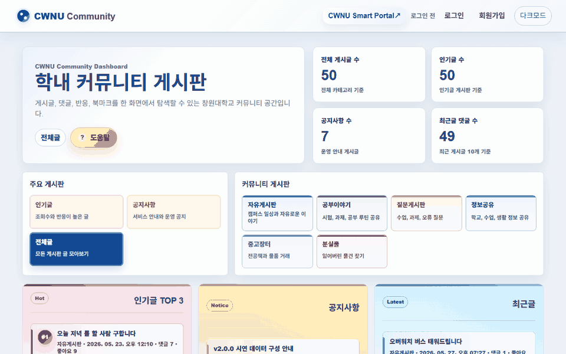
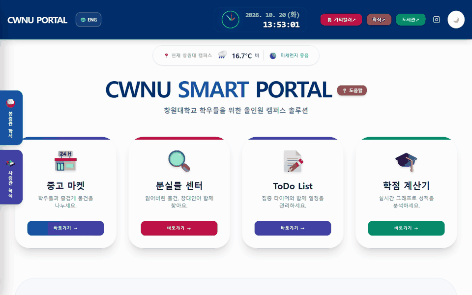
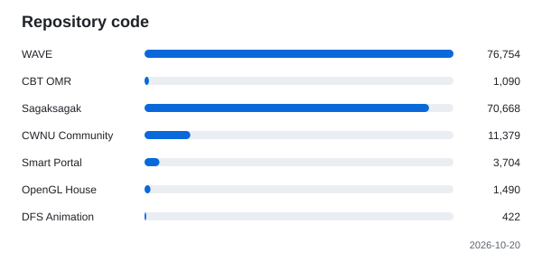

<!-- Generated from README.template.md and src/projects.ts. Run npm run generate. -->

<picture>
  <source media="(prefers-color-scheme: dark)" srcset="assets/generated/workshop-dark.svg" />
  
</picture>

<h1 align="center">정이량의 제작실</h1>

<strong>작게 만들고, 실제로 쓰는 것들.</strong> 컴퓨터공학 전공 · 공부와 일상에 필요한 도구를 만들고, 웹 서비스와 인터랙티브 프로젝트로 확장합니다.

<a href="#대표-프로젝트">대표 프로젝트</a> · <a href="#기여-기록과-코드-규모">기여 기록</a> · <a href="#작업-보관함">작업 보관함</a>

## 대표 프로젝트

직접 만든 공개 원본 프로젝트 중 구현과 결과를 확인할 수 있는 작업을 골랐습니다. 팀 프로젝트는 역할을 함께 적었습니다.

<table>
  <tr>
    <td colspan="2" width="100%" valign="top">
      
      
실제 배포 화면 · 홈 → 여행 설계 → 관광지 상세·편의정보 · 2026.10.20 촬영

      <h3><a href="https://github.com/jeongiryang/wave-barrier-free-gyeongnam">WAVE</a></h3>
      
<strong>공개 서비스 · 주요 기능 구현</strong> 관광 데이터 활용 프로젝트

      
경남 관광·공식 편의정보를 연결한 여행 일정 서비스 여행지 탐색, 날짜별 일정·지도, 대화형 일정 편집과 저장·공유를 제공합니다.

      
TypeScript · React · Vite / Vinext · Neon / Vercel

      
<a href="https://github.com/jeongiryang/wave-barrier-free-gyeongnam">코드와 제작 기록 ↗</a> · <a href="https://wave-barrier-free-gyeongnam.vercel.app/">사용해 보기 ↗</a>

    </td>
  </tr>
  <tr>
    <td width="50%" valign="top">
      
      
실제 배포 화면 · OMR 마킹 → 자동 채점 · 2026.10.20 촬영

      <h3><a href="https://github.com/jeongiryang/cbt-omr-tester">CBT OMR Tester</a></h3>
      
<strong>v1.0.0 · 완성</strong> 개인 프로젝트

      
설치 없이 브라우저에서 사용하는 OMR · 자동 채점 도구 시험 프리셋, 타이머, 정답 비교와 합격·과락 판정을 한 화면에 담았습니다.

      
HTML · CSS · JavaScript

      
<a href="https://github.com/jeongiryang/cbt-omr-tester">코드와 제작 기록 ↗</a> · <a href="https://cbt-omr-tester.vercel.app/">사용해 보기 ↗</a>

    </td>
    <td width="50%" valign="top">
      
      
실제 배포 화면 · 로그인 전 공개 소개 · 2026.10.20 촬영

      <h3><a href="https://github.com/jeongiryang/SoftwareEngineering_team15_project_-Smart-Edu-Platform">사각사각</a></h3>
      
<strong>v2.10.3 · 과제 완료</strong> 3인 팀 · 팀장 / 통합·검증·배포·UI/UX

      
학습 자료와 노트·퀴즈를 연결하는 학습 관리 앱 PDF 기반 학습 지원과 실시간 스터디 기능을 구현하고 최종 제출을 마쳤습니다.

      
Expo · React Native Web · Express · PostgreSQL / Prisma

      
<a href="https://github.com/jeongiryang/SoftwareEngineering_team15_project_-Smart-Edu-Platform">코드와 제작 기록 ↗</a> · <a href="https://sagaksagak-smart-edu.vercel.app/">사용해 보기 ↗</a>

    </td>
  </tr>
  <tr>
    <td width="50%" valign="top">
      
      
실제 배포 화면 · 게시판 → 공지 상세 · 2026.10.20 촬영

      <h3><a href="https://github.com/jeongiryang/DatabaseLanguage_NodeJS_CWNU-Community">CWNU Community</a></h3>
      
<strong>v2.0.1 · 과제 완료</strong> 개인 과제

      
Node.js와 PostgreSQL로 만든 대학 커뮤니티 게시판 회원가입·로그인부터 게시글, 댓글, 반응과 페이지 이동까지 구현했습니다.

      
JavaScript · Node.js · PostgreSQL · Vercel

      
<a href="https://github.com/jeongiryang/DatabaseLanguage_NodeJS_CWNU-Community">코드와 제작 기록 ↗</a> · <a href="https://cwnu-community.vercel.app/">사용해 보기 ↗</a>

    </td>
    <td width="50%" valign="top">
      
      
실제 배포 화면 · 메인 → 학점계산기 · 2026.10.20 촬영

      <h3><a href="https://github.com/jeongiryang/todo-app-mini-project-20222017">CWNU Smart Portal</a></h3>
      
<strong>v1.1.0 · 과제 완료</strong> 개인 과제

      
ToDo와 학교 생활 도구를 모은 웹 미니 프로젝트 할 일 관리, 타이머·스톱워치와 학점계산기를 연결하고 배포했습니다.

      
React · Vite · Express · MongoDB

      
<a href="https://github.com/jeongiryang/todo-app-mini-project-20222017">코드와 제작 기록 ↗</a> · <a href="https://todo-app-mini-project-20222017.vercel.app/">사용해 보기 ↗</a>

    </td>
  </tr>
</table>

## 기여 기록과 코드 규모

<picture>
  <source media="(prefers-color-scheme: dark)" srcset="assets/generated/github-stats-dark.svg" />
  
</picture>

<picture>
  <source media="(prefers-color-scheme: dark)" srcset="assets/generated/source-scale-dark.svg" />
  
</picture>

> 코드 규모는 선정한 공개 원본 7개의 현재 HEAD를 cloc으로 측정합니다. 외부 라이브러리·생성물·lock 파일 등은 제외하며, 팀 전체 코드도 포함되어 **개인 작성량이나 작업 시간과는 다릅니다.** [집계 기준](docs/setup.md#코드-규모)

<picture>
  <source media="(prefers-color-scheme: dark)" srcset="assets/generated/contribution-snake-dark.svg" />
  
</picture>

실제 GitHub 기여 달력을 시각화합니다. 기여 수와 커밋 수는 같은 지표가 아닙니다.

## 작업 보관함

완료한 수업 프로젝트와 실험 보기

| 프로젝트 | 만든 결과 | 기술 |
|---|---|---|
| [OpenGL 3D House](https://github.com/jeongiryang/Computer-Graphics_project_Team1) | OpenGL로 구현한 3D 집과 주변 환경 | C++ · OpenGL |
| [DFS Animation](https://github.com/jeongiryang/AlgorithmAnimation_DFS-AnimalScript_Assignment) | 그래프 탐색 과정을 AnimalScript 애니메이션으로 변환 | Python · AnimalScript |
| [TCP / UDP 실험](https://github.com/jeongiryang/Network-Programming_TCP_and_UDP-Analysis) | 전송 조건에 따른 TCP·UDP 성능 비교 | C · Socket |
| [너구리 게임](https://github.com/jeongiryang/Advanced_Data_Structures_Team6) | 기존 C 게임의 오류 분석과 수정 | C |
| [Python 던전 게임](https://github.com/jeongiryang/OpenSource_1_team-project) | 팀이 함께 만든 텍스트 기반 던전 게임 | Python |
| [웹 프로그래밍 프로젝트](https://github.com/jeongiryang/WebProgramming_team-project) | ToDo · 중고 마켓의 기본 기능 구현 | HTML · CSS · JavaScript · Node.js |
| [Checksum Generator](https://github.com/jeongiryang/Network-Programming_Checksum-Generator) | Even Parity 기반 16-bit 체크섬 생성기 | C · Network |
| [MariaDB SQL 실습](https://github.com/jeongiryang/DatabaseLanguage_SQL_Assignment) | 요구사항에 맞는 DDL · DML · 질의 작성 | SQL · MariaDB |
| [Animal Animation](https://github.com/jeongiryang/Algorithm_animal-animation_tool) | 점 데이터의 알고리즘 애니메이션 생성 | Python · AnimalScript |
| [Hadoop / HDFS 실습](https://github.com/jeongiryang/BigData_Kubernetes_Hadoop_HDFS_Assignment) | Kubernetes에서 HDFS 실행과 저장 확인 | Kubernetes · Hadoop |

개발 중인 서비스와 프로토타입 보기

아래 작업은 완성작과 구분해 기록합니다.

| 프로젝트 | 현재 단계 | 내용 |
|---|---|---|
| [Ontology / Knowledge Graph](https://github.com/jeongiryang/kg-ontology-decision-framework) | 연구 PoC | 온톨로지와 지식그래프 기반 의사결정 지원 PoC |
| [Kitchen Mood Radio](https://github.com/jeongiryang/lg-ax-hackathon-cwnu-2026) | 초기 프로토타입 | LG AX 해커톤 Android 앱 초기 개발 |

만드는 방식과 프로필 도구

요구사항을 작은 작업으로 나누고, Issue → branch → PR → 검증 → 문서 기록으로 이어갑니다. AI 에이전트는 구현과 검토를 돕는 도구로 사용합니다.

- [프로필에 적용한 오픈소스와 후보 도구](docs/profile-toolbox.md)
- [완성 저장소를 꾸밀 순서와 계획](docs/repository-presentation-plan.md)
- [통계의 집계 범위와 관리 방법](docs/setup.md)

